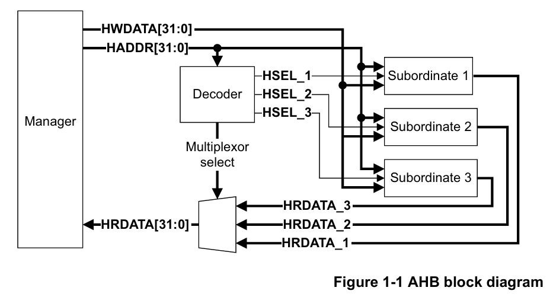
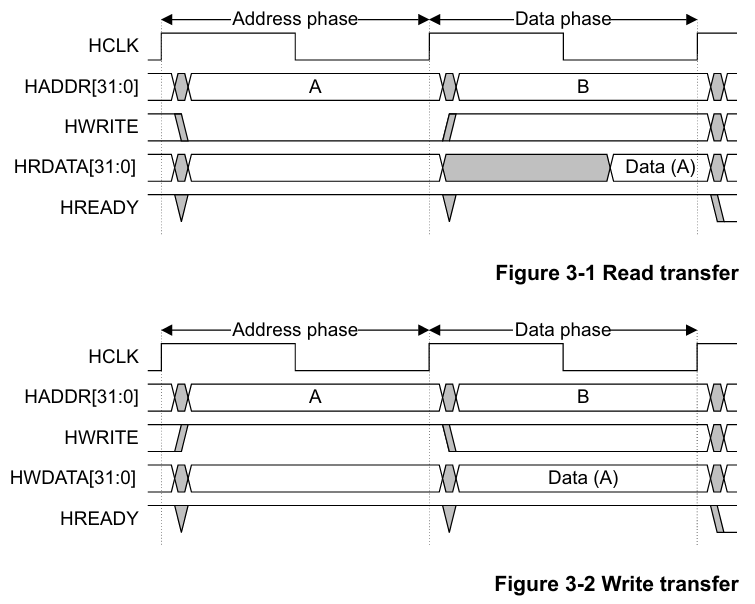
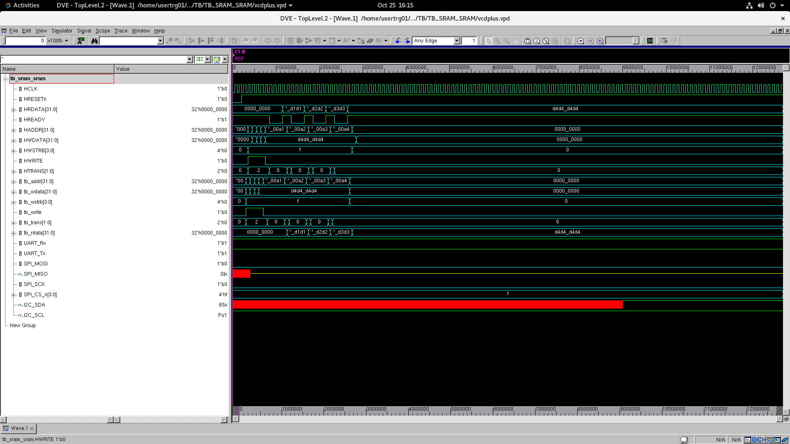
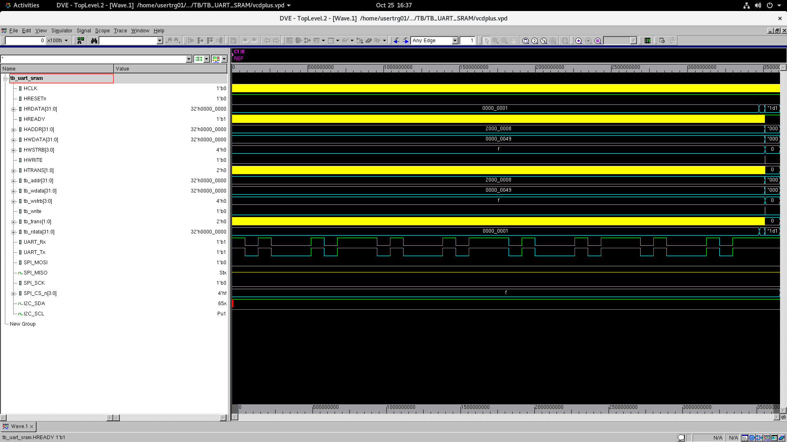
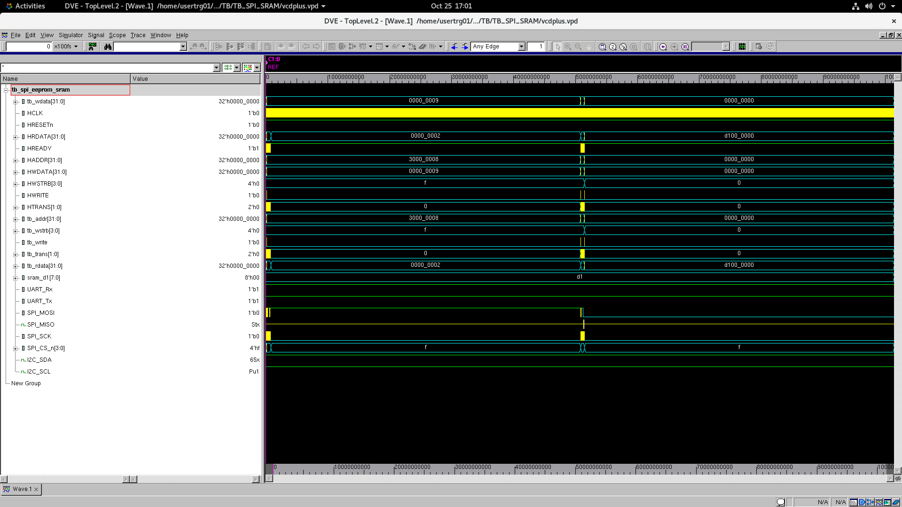
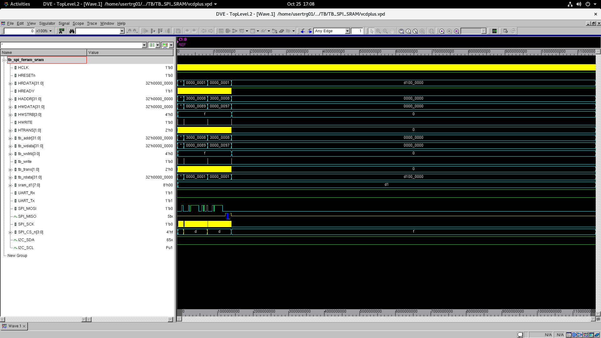
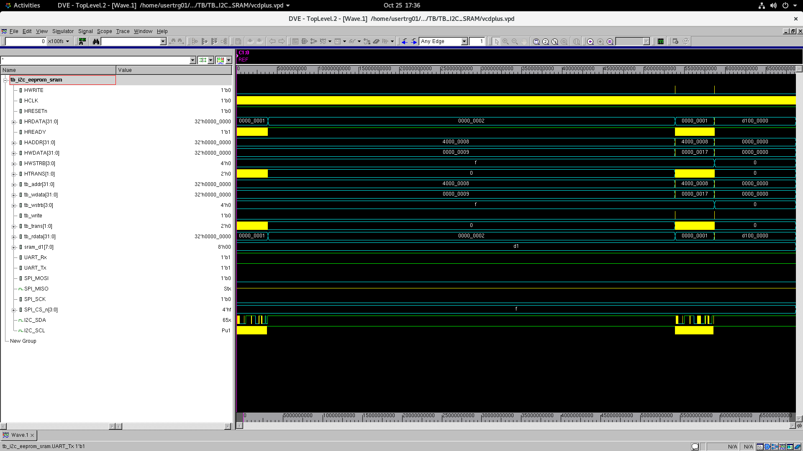
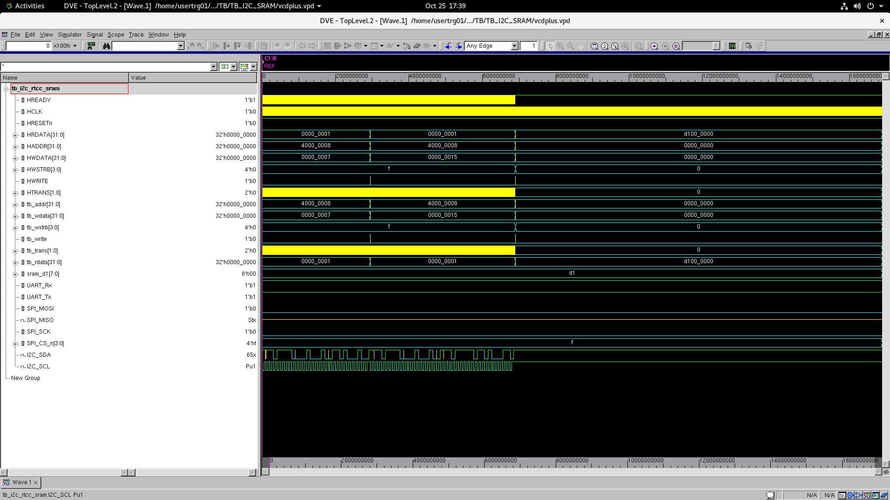
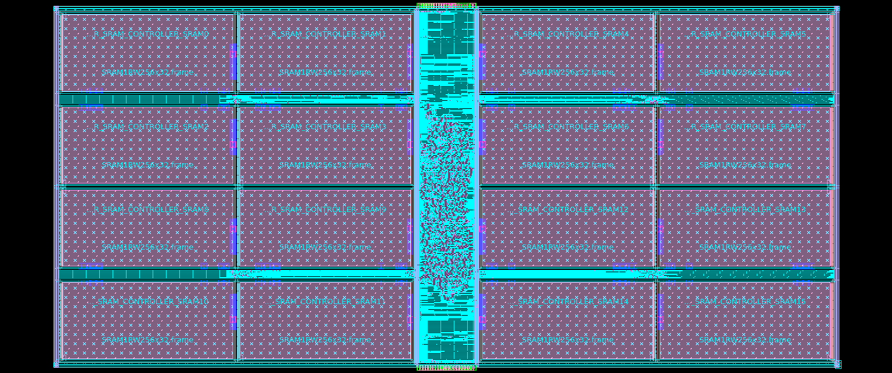

# AMBA_AHB_Peripheral_Subsystem

An AHB peripheral subsystem with SRAM, UART, SPI and I2C, built in Verilog and carried through to physical implementation using SAED 32 nm libraries.

For this project, I worked through the connection between the bus, the peripheral controllers and the memory, then took the design through synthesis, place and route, and timing analysis. The testbenches follow data from SRAM through the serial peripherals and back into SRAM, so the simulations cover the complete transfer path.

## Subsystem Architecture

The design has a shared 32-bit AHB address and data interface. An address decoder selects one of four peripheral wrappers, and a response multiplexer returns the selected peripheral's read data and ready signal.

Each wrapper connects the AHB interface to its controller. UART, SPI and I2C have register blocks for configuration, data and status. UART includes the baud-rate generator, transmitter and receiver; SPI exposes four chip-select outputs; I2C uses bidirectional SDA and SCL lines.

The connections are in [`ahb_peripheral_top.v`](RTL/ahb_peripheral_top.v), with the address ranges defined in [`ahb_decmux.v`](RTL/ahb_decmux.v).

| Peripheral | Address range |
| --- | --- |
| SRAM | `0x0000_0000 - 0x0000_FFFF` |
| UART | `0x2000_0000 - 0x2000_00FF` |
| SPI | `0x3000_0000 - 0x3000_00FF` |
| I2C | `0x4000_0000 - 0x4000_00FF` |

### AHB Transfers

The AHB interface handles the bus transaction before passing it to the peripheral logic. The diagram below shows the basic transfer timing. The design uses `HTRANS` to identify transfers, `HWSTRB` for byte selection, and `HREADY` to control when the bus can move on.

## RTL Simulation

The test environment uses an AHB bus functional model to access the subsystem. Outside the design are the UART loopback connection and the SPI and I2C device models shown below.

The serial tests start with data in SRAM, send it through the selected peripheral, read it back and write it to another SRAM location. That connects the bus accesses, peripheral register handling and serial communication in one test sequence. The six waveform captures below correspond to the testbenches in [`TB/`](AMBA_AHB_Peripheral_Subsystem/TB/).

### Bus Functional Model (BFM)

The [`ahb_bfm.v`](AMBA_AHB_Peripheral_Subsystem/TB/ahb_bfm.v) module is a simple driver for the AHB signals used in these testbenches. It takes the address, write data, byte strobes, read/write control and transfer type from the testbench, then drives `HADDR`, `HWDATA`, `HWSTRB`, `HWRITE` and `HTRANS`. Signal updates are gated by `HREADY`, write data is delayed through a register, and `HRDATA` is sampled back to the testbench as `tb_rdata`.

The BFM is only used to generate the directed read and write transactions needed for the peripheral tests. It is not a complete AHB master or verification IP, and does not include protocol assertions, constrained-random stimulus, a scoreboard or functional coverage. The test sequences are defined in the individual testbenches; the BFM itself does not check protocol compliance or verify the returned data.

### SRAM to SRAM

The SRAM test covers memory accesses through the AHB wrapper and SRAM controller. It provides the memory path used by the serial tests that follow.

### SRAM to UART to SRAM

Data read from SRAM is loaded into the UART transmitter. With TX connected to RX, the transmitted data returns through the receiver and is written to a second SRAM location.

### SRAM to SPI EEPROM to SRAM

The EEPROM test reads a byte from SRAM, sends the write-enable command, and writes the byte to EEPROM address `0x7FF0`. After the model's 5 ms write cycle, it reads the byte back through SPI and stores it in SRAM.

### SRAM to SPI FeRAM to SRAM

The FeRAM test also transfers a byte from SRAM to address `0x7FF0` in the external device, then reads it back into SRAM. This gives the SPI controller a second memory model to communicate with.

### SRAM to I2C EEPROM to SRAM

The I2C EEPROM test writes the SRAM byte to device address `0x7FF0`, waits for the 5 ms internal write cycle, then reads it back and stores it at another SRAM location.

### SRAM to I2C RTCC to SRAM

The real-time clock/calendar test uses the device's SRAM at address `0x22`. A byte from the subsystem SRAM is written over I2C, read back from the RTCC and returned to the subsystem SRAM.

## Synthesis and Physical Design

The implementation flow uses Synopsys Design Compiler for synthesis, IC Compiler II for physical design and PrimeTime for static timing analysis. The synthesis clock target is **100 MHz**, with a **10 ns period** defined in [`cons.tcl`](DC/scripts/cons.tcl).

After synthesis, the physical design work covers floorplanning, placement, clock-tree synthesis and routing. Timing analysis and ECO iterations follow, with reports retained for both fast and slow corners.

### Timing and Physical Verification Results

The post-DRC-fix PrimeTime reports from ECO iteration 9 show no setup or hold violations in either corner. The routing and connectivity checks below are from the ICC2 routing stage.

| Check | Result | Report |
| --- | --- | --- |
| PrimeTime setup and hold, slow corner | No violations in ECO iteration 9, post-DRC fix | [Slow timing](PT/reports/eco_iter_9/post_drc_fix/slow/global_timing.rpt) |
| PrimeTime setup and hold, fast corner | No violations in ECO iteration 9, post-DRC fix | [Fast timing](PT/reports/eco_iter_9/post_drc_fix/fast/global_timing.rpt) |
| ICC2 routing | 0 open nets, 0 DRCs, 0 antenna violations | [Routing check](ICC2/reports/Routing/check_routes.rpt) |
| ICC2 connectivity | 0 shorts, 0 opens, 0 floating routes | [Connectivity check](ICC2/reports/Routing/check_lvs.rpt) |

Two maximum-capacitance violations remain on SRAM output pins in the slow-corner ECO iteration 9 [constraint report](PT/reports/eco_iter_9/post_drc_fix/slow/cons_all_violators.rpt), with slack of -0.06 and -0.02. Setup and hold are clear at that stage; the capacitance checks still need attention.

## Repository Structure

| Folder | Contents |
| --- | --- |
| [`Screenshot/`](Screenshot/) | Architecture diagrams, simulation waveforms and layout screenshots |
| [`RTL/`](RTL/) | Top-level module, AHB decoder/multiplexer, peripheral wrappers, registers and controllers |
| [`AMBA_AHB_Peripheral_Subsystem/`](AMBA_AHB_Peripheral_Subsystem/) | Simulation RTL, behavioural models and testbenches, including the AHB BFM |
| [`Behavioural_Models/`](Behavioural_Models/) | Memory and peripheral device models |
| [`DC/`](DC/) | Synthesis scripts, constraints, reports and gate-level simulation testbenches |
| [`ICC2/`](ICC2/) | Physical design scripts, floorplan files and reports |
| [`PT/`](PT/) | Timing analysis scripts, ECO scripts and fast/slow corner reports |
| [`libs_saed32nm_with_sram_20July2026/`](libs_saed32nm_with_sram_20July2026/) | Technology libraries |
| [`SAED_RTL/`](SAED_RTL/) | Standard-cell simulation models |

The scripts and file lists still use the original project paths. To run the project in another environment, those paths will need to be updated. Generated simulator builds, waveform databases and tool working databases are ignored; the source, libraries, reports and screenshots are included.

## Future Update/Fixes: (Hopefully)

- Fix physical DRCs with IC Validator.
- Improve peripheral architecture.
- Improve subordinates wait states.
- Validate gate-level simulations with timing checks.
